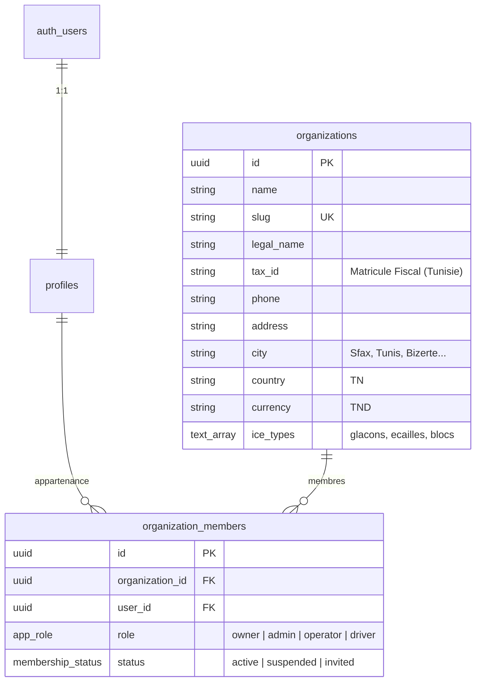

# FROSTSCALE619 — Multi-Tenant SaaS ERP

> ERP industriel multi-tenant pour les fabricants de glace en Tunisie (*Glaçons, Écailles, Blocs de glace*).

## Aperçu Technique — Phase 1 : Fondation

FROSTSCALE619 est un monolithe modulaire conçu pour un budget de développement de 0 $ et une empreinte mémoire légère (optimisé pour Linux 8 Go RAM).

### Pile Technologique
- **Framework** : Next.js 16 (App Router) + React 19
- **Base de données** : PostgreSQL hébergé sur Supabase
- **Authentification & SSR** : `@supabase/ssr` avec cookies HTTP-only
- **Sécurité des données** : PostgreSQL Row-Level Security (RLS) avec isolation stricte multi-tenant
- **Validation** : Zod
- **Style & UI** : Tailwind CSS + shadcn/ui + Lucide Icons
- **Tests automatisés** : Vitest (Node.js test runner rapide & léger)

---

## Modèle Multi-Tenant & Architecture

Chaque entreprise manufacturière de glace constitue une **organisation** (`organization_id`).



### Rôles & Permissions

| Rôle | Périmètre d'action |
| :--- | :--- |
| **`owner`** | Dirigeant / Propriétaire de l'usine. Gestion complète, matricule fiscal, membres et suppression. |
| **`admin`** | Gestionnaire d'usine / Responsable de site. Gestion des installations et des tournées. |
| **`operator`** | Opérateur de production. Saisie des lots de glace, pesées et suivi des machines (Phase 2). |
| **`driver`** | Chauffeur livreur. Accès aux bons de livraison et consignes de bacs isothermes. |

---

## Architectural Decision Records (ADR)

### ADR-001 : Isolation Multi-Tenant par PostgreSQL RLS
- **Décision** : Enforcer l'isolation multi-tenant au niveau du moteur PostgreSQL via Row Level Security (RLS) plutôt qu'uniquement dans la couche applicative.
- **Justification** : Élimine le risque de fuite de données inter-entreprises (BOLA / IDOR) si un développeur oublie un filtre `where organization_id = ...` dans une requête.
- **Optimisation** : Toutes les politiques RLS encapsulent les appels de fonction dans `(select auth.uid())` pour éviter la réévaluation par ligne sur les parcours séquentiels.

### ADR-002 : Résolution du Contexte Tenant Côté Serveur
- **Décision** : Ne jamais faire confiance à un `organization_id` provenant du navigateur (query string ou body non vérifié).
- **Justification** : Le serveur valide que l'utilisateur connecté possède une appartenance active (`organization_members`) avant toute action ou rendu de page.

---

## Installation & Démarrage Local

### Prérequis
- Node.js 24 LTS
- Compte Supabase (base de données de développement hébergée)

### 1. Variables d'Environnement
Créer le fichier `.env.local` à la racine de `frostscale619/` :
```env
NEXT_PUBLIC_SUPABASE_URL=https://[VOTRE_PROJET].supabase.co
NEXT_PUBLIC_SUPABASE_PUBLISHABLE_KEY=sb_publishable_...
```

### 2. Application de la Migration Supabase
Exécuter le script SQL suivant dans le **SQL Editor** de votre tableau de bord Supabase :
```text
supabase/migrations/20261106000001_phase1_initial_schema.sql
```
Ce script crée les types enum, les tables `profiles`, `organizations`, `organization_members`, les fonctions de sécurité et l'ensemble des politiques RLS.

### 3. Démarrage du Serveur de Développement
```bash
npm run dev
```
L'application est accessible sur [http://localhost:3000](http://localhost:3000).

### 4. Lancement des Tests Automatisés
```bash
npm test
```

### 5. Construction de Production
```bash
npm run build
npm start
```

---

## Structure du Projet

```text
frostscale619/
├── app/
│   ├── auth/                # Connexion, Inscription, Réinitialisation
│   ├── dashboard/           # Tableau de bord usine (protégé par tenant)
│   ├── onboarding/          # Configuration initiale de l'entreprise
│   ├── settings/            # Paramètres de l'usine (filtré par rôle)
│   ├── globals.css          # Thème cold-chain (Tailwind CSS v3)
│   └── layout.tsx           # Layout racine avec ThemeProvider
├── components/
│   ├── dashboard/           # Vue d'ensemble usine & lignes de glace
│   ├── layout/              # En-tête multi-tenant avec badge de rôle
│   ├── onboarding/          # Formulaire d'onboarding usine
│   ├── settings/            # Formulaire de modification coordonnées
│   └── ui/                  # Composants shadcn/ui
├── lib/
│   ├── actions/             # Server actions Zod-validées
│   ├── supabase/            # Clients SSR (client, server, proxy)
│   ├── tenant/              # Résolution du contexte d'organisation
│   └── validations/         # Schémas Zod (auth, organization)
├── supabase/
│   └── migrations/          # Migrations SQL versionnées
├── types/
│   ├── auth.ts              # Types de contexte d'authentification
│   └── database.ts          # Types TypeScript miroirs de PostgreSQL
└── __tests__/               # Tests unitaires Vitest
```
