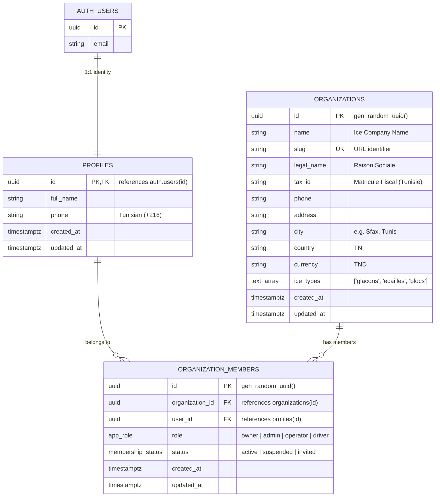

# FROSTSCALE619 — Phase 1: Foundation
## Technical Architecture Proposal & Implementation Plan

As Principal Software Architect and Senior Full-Stack Engineer, I have completed the codebase inspection and prepared the architectural blueprint and implementation plan for Phase 1.

---

### 1. Inspection Findings & Missing Configuration

| Component | Current State | Issues / Missing Items |
| :--- | :--- | :--- |
| **Workspace & Project Structure** | Next.js 16.4 (App Router) + React 19 inside `frostscale619/` | Standalone template contains generic tutorial files (`components/tutorial/*`, `hero.tsx`, `deploy-button.tsx`, etc.) that do not reflect FROSTSCALE619's domain. |
| **Request Proxy & Routing** | Next.js 16 request proxy in `proxy.ts` + `lib/supabase/proxy.ts` | The proxy lacks route guards for multi-tenant onboarding (`/onboarding`), tenant dashboard (`/dashboard`), and company settings (`/settings`). |
| **Validation Layer** | Not installed | `zod` is absent from `package.json`. Server actions and form inputs currently lack strict schema validation. |
| **Testing Infrastructure** | Not configured | No test framework installed. Need a lightweight test runner (`vitest`) tailored for 8 GB RAM and zero-dollar budget. |
| **Database Migrations** | No migration tracking folder | No `supabase/migrations/` directory exists. Schema needs versioned, reproducible SQL migrations. |
| **Environment & Connectivity** | Hosted Supabase project configured in `.env.local` | `NEXT_PUBLIC_SUPABASE_URL` and `NEXT_PUBLIC_SUPABASE_PUBLISHABLE_KEY` are present. Service-role keys are securely excluded. |

---

### 2. Multi-Tenant Architecture & Domain Modeling

FROSTSCALE619 is designed for Tunisian edible-ice manufacturers (*Glaçons, Écailles, Blocs*). In Tunisia, manufacturers manage ice plants, cold rooms, delivery fleets, and weighing scales across governorates (Sfax, Tunis, Bizerte, Sousse, etc.).

#### Role & Permission Matrix

| Role | Operational Scope in Ice ERP | Permissions |
| :--- | :--- | :--- |
| `owner` | Ice Factory Founder / Executive | Full administrative control: company legal settings, Matricule Fiscal, user memberships, billing, and system audit logs. |
| `admin` | Plant & Operations Manager | Manages facilities, assigns operators, oversees all production batches (Cubes, Flakes, Blocks) and dispatch routes. Cannot delete company. |
| `operator` | Ice Plant Floor Operator | Logs ice production batches, machine runtimes, and scale weight measurements. Cannot alter company settings or invite members. |
| `driver` | Delivery / Logistics Driver | Views assigned ice delivery orders, confirms thermal container handovers and bin returns. Read-only on dispatch. |

---

### 3. Database & Security Schema Design

Following the [Supabase Postgres Best Practices](file:///mnt/MyDATA/P1-2027/FrostScale619_SAAS/frostscale619/.agents/skills/supabase-postgres-best-practices/SKILL.md) guidelines:

1. **UUID Primary Keys & Timestamps**: All entities use `UUID PRIMARY KEY DEFAULT gen_random_uuid()`, with `created_at` and `updated_at` governed by an automated trigger.
2. **Composite Tenant-Safe Constraints**:
   - `organization_members`: `UNIQUE (organization_id, user_id)`
   - Composite B-Tree indexes: `idx_org_members_user_org (user_id, organization_id)` and `idx_org_members_org_role (organization_id, role)`.
3. **Database RLS Policies**:
   - Wrapped queries: Functions like `(select auth.uid())` are wrapped in subqueries to evaluate once per query plan rather than per-row.
   - `SECURITY DEFINER` helper functions with strict `search_path = ''`:
     - `public.get_user_org_ids()`: Returns all active organization IDs for the calling user.
     - `public.is_org_member(target_org_id uuid, allowed_roles app_role[])`: Validates membership and role.
   - Policies enforced:
     - `organizations`: Only members can `SELECT`. Only `owner` can `UPDATE`.
     - `organization_members`: Members can view fellow members in their organization. Only `owner`/`admin` can modify memberships.
     - `profiles`: Users can read and update their own profile; members can view profiles of colleagues within the same organization.

---

### 4. Server-Side Tenant Authorization & Session Handling

1. **Zero Client Trust**: As mandated by `AGENTS.md`, the browser is never trusted for tenant authorization. The server determines the active organization via:
   - Validated secure HTTP-only cookie (`frostscale_org_id`).
   - Server-side verification confirming the authenticated `auth.uid()` has an active membership in that organization.
   - Fallback: Default to user's primary organization, or redirect to `/onboarding` if none exists.
2. **Next.js 16 Request Proxy (`proxy.ts`)**:
   - Refreshes Supabase session tokens on incoming requests.
   - Protects `/dashboard/*`, `/settings/*`, and `/onboarding` routes from unauthenticated access.
   - Redirects authenticated users without an organization to `/onboarding`.

---

### 5. Frontend & UI Architecture

Clean, modular, responsive interface adopting a specialized **Cold-Chain Industrial Theme** (deep slate `#0f172a`, arctic blue `#0ea5e9`, frost accents):

1. **Auth (`/auth/login`, `/auth/sign-up`)**:
   - Polished login and sign-up with client & server-side Zod validation.
   - Tunisian phone formatting assistance and clear error feedback.
2. **Company Onboarding (`/onboarding`)**:
   - Multi-step or streamlined single-view form for new ice manufacturing tenants:
     - Company Name & Raison Sociale.
     - Tunisian Matricule Fiscal (Tax ID).
     - Governorates/Cities (Tunis, Sfax, Sousse, Bizerte, Nabeul, etc.).
     - Ice product lines manufactured: Glaçons (Cubes) 🧊, Écailles (Flakes) ❄️, Blocs (Blocks) 🧊.
   - Automatically provisions the organization, assigns the creator as `owner`, and directs to `/dashboard`.
3. **Protected Multi-Tenant Dashboard (`/dashboard`)**:
   - Active Organization header with quick switch / profile details.
   - Ice Factory Status Overview: Active Ice Lines (*Glaçons*, *Écailles*, *Blocs*), Plant health indicator, and Operator quick stats.
   - Clean navigation to Company Settings and future Phase 2 modules.
4. **Company Settings (`/settings`)**:
   - Edit organization profile, legal information, contact details, and enabled ice lines.
   - Role-gated: Operators see read-only view; Owners/Admins have mutation access.
5. **UI States**:
   - Skeleton loaders, pending button spinners (`disabled` while submitting), error alerts, and toast confirmations.

---

### 6. Implementation Plan

#### Step 1: Dependencies & Core Tooling
- Install `zod` for schema validation.
- Install `vitest` for lightweight, fast automated testing (compatible with Node 24 and 8 GB RAM).

#### Step 2: Database Migration Creation
- Create `frostscale619/supabase/migrations/20261106000001_phase1_initial_schema.sql` containing:
  - Custom types: `app_role` (`owner`, `admin`, `operator`, `driver`), `membership_status` (`active`, `suspended`, `invited`).
  - Tables: `profiles`, `organizations`, `organization_members`.
  - Indexes, FKs, and `set_updated_at` trigger.
  - Auth trigger: Automatically create `profiles` row on `auth.users` insert.
  - Security helper functions (`get_user_org_ids`, `is_org_member`).
  - Strict RLS policies on all three tables.

#### Step 3: Domain Types, Validation & Security Utilities
- Create `frostscale619/types/database.ts` and `frostscale619/types/auth.ts`.
- Create `frostscale619/lib/validations/organization.ts` and `auth.ts` (Zod schemas).
- Create `frostscale619/lib/tenant/context.ts`: Server-side tenant resolver and role authorizer.

#### Step 4: Server Actions & Business Logic
- Create `frostscale619/lib/actions/organization.ts`:
  - `createOrganizationAction`: Validates inputs, creates company, links creator as `owner`.
  - `updateOrganizationAction`: Verifies `owner`/`admin` role before updating company settings.
  - `switchOrganizationAction`: Sets active organization cookie after validating membership.
- Update `proxy.ts` and `lib/supabase/proxy.ts` to enforce tenant route guarding.

#### Step 5: Frontend Pages & Components
- Update `frostscale619/app/auth/login/page.tsx` & `components/login-form.tsx`.
- Create `frostscale619/app/onboarding/page.tsx` & `components/onboarding/onboarding-form.tsx`.
- Create `frostscale619/app/dashboard/page.tsx` & `components/dashboard/ice-factory-overview.tsx`.
- Create `frostscale619/app/settings/page.tsx` & `components/settings/company-settings-form.tsx`.
- Add reusable navigation, loading states, and error boundaries.

#### Step 6: Automated Testing & Verification
- Unit tests: Zod schemas, role permissions matrix, tenant isolation rules.
- Integration test suite: Verifies cross-tenant data leakage prevention (proving Tenant A cannot access or mutate Tenant B records).
- Type checking (`tsc --noEmit`) and lint check.

---

### 7. Phase 1 Implementation Status: COMPLETED & VERIFIED
- Schema migration `20261106000001_phase1_initial_schema.sql` applied.
- Supabase SSR cookies, RLS policies, Zod validation, and tenant isolation active.
- Vitest automated tests passing (11/11 tests).

---

# FROSTSCALE619 — Phase 2: Master Data, Cold Facilities & Ice Catalog
## Architecture & Implementation Report (COMPLETED)

### 1. Database Schema
- Migration: `supabase/migrations/20261106000002_phase2_facilities_and_products.sql`
- Custom Enums: `storage_location_type` (`cold_room`, `flake_silo`, `buffer_pit`), `machine_status` (`operational`, `maintenance`, `offline`), `ice_production_type` (`glacons`, `ecailles`, `blocs`), `product_unit` (`sac`, `kg`, `bloc`, `tonne`, `caisse`).
- Tables:
  - `facilities`: Factory sites, ports, and depots with composite unique code `(organization_id, code)`.
  - `storage_locations`: Cold storage rooms (*Chambres froides*), flake silos (*Silos à écailles*), buffer pits with target temperatures and capacities.
  - `machines`: Ice generators (Scotsman, Geneglace, brine tanks for blocks) with production capacity in tonnes/24h.
  - `ice_products`: Commercial catalog with prices in Dinar Tunisien (`TND`, numeric 10,3).
- RLS: Member SELECT, Owner/Admin mutations.

### 2. Frontend & Server Actions
- Server actions: `lib/actions/facilities.ts`, `lib/actions/products.ts`.
- Routes: `/facilities`, `/products` with cold-chain UI theme.
- Navigation: Header updated with direct links to facilities and catalog.
- Tests: `facilities-validation.test.ts`, `products-validation.test.ts` (10 passing tests).

---

# FROSTSCALE619 — Phase 3: Production Batches & Append-Only Inventory
## Architecture & Implementation Report (COMPLETED)

### 1. Business Integrity & Technical Design
- **Append-Only Inventory Ledger**: Stock is never mutated with naive updates; every change is an immutable entry in `inventory_movements`.
- **Audit Guard Trigger**: PostgreSQL trigger `trg_prevent_inventory_movement_mutation` prevents any `UPDATE` or `DELETE` on `inventory_movements`.
- **Atomic Batch Completion**: Procedure `complete_production_batch_atomic` closes production batches and deposits stock into cold rooms in a single transaction.
- **Melt Loss Accounting (*Fondue de Glace*)**: Ambient losses and defrost cycles are recorded as `melt_loss` with negative deltas.

### 2. Database Schema
- Migration: `supabase/migrations/20261106000003_phase3_production_and_inventory.sql`
- Enums: `batch_status` (`in_progress`, `completed`, `cancelled`), `inventory_movement_type` (`production_in`, `dispatch_out`, `transfer`, `melt_loss`, `adjustment`).
- Tables:
  - `production_batches`: Traceable batch number, runtime hours, utility meters (water m³, electricity kWh), operator profile.
  - `inventory_movements`: Immutable append-only ledger with signed quantity and weight deltas.

### 3. Frontend & Server Actions
- Server actions: `lib/actions/production.ts`, `lib/actions/inventory.ts`.
- Routes:
  - `/production`: Active production batches on the factory floor, machine selection, runtime logging, and 1-click stock deposit.
  - `/inventory`: Real-time stock gauges per cold storage room and silo, melt loss declaration (*Fondue de glace*), and audit history ledger.
- Navigation: Tenant header updated with links to **Production** and **Stocks Froids**.
- Route Protection: Proxy updated to guard `/production` and `/inventory`.
- Tests: `production-validation.test.ts`, `inventory-validation.test.ts` (9 passing tests).
- Total Automated Test Suite: 30/30 tests passing. All 21 Next.js routes building cleanly.

---

# FROSTSCALE619 — Phase 4: Sales, Logistics, Tracking & Invoicing
## Implementation Status: IN PROGRESS (Tracking Map & PDF Generator COMPLETED)

### 1. Geolocated Client Tracking Map (Dashboard)
- **Library**: `react-leaflet` with OpenStreetMap raster tiles (100% Free, $0 budget).
- **Architecture**: Next.js App Router dynamic SSR-safe wrapper (`client-tracking-wrapper.tsx` & `client-tracking-map.tsx`).
- **Cold-Chain Markers**: Custom SVG/DivIcon markers color-coded by client segment (Mareyeurs 🌊, Poissonneries 🐟, CHR 🏨, Pêcheurs 🚢, Industriels 🏭).
- **Real-Time Radar**: Animated pulsing ring on pins with active deliveries in transit (`in_transit`).
- **Thermal Containers Tracking**: Overlay badge on each marker showing thermal containers (*bacs isothermes consignés*) currently held at the customer's site.
- **Interactive Popup**: Direct link to 1-click generate and view official Tunisian TND invoices in PDF.

### 2. Server-Side TND Invoice Generation
- **Library**: `@react-pdf/renderer`.
- **Route Handler**: `/api/invoices/[clientId]/pdf` generating standard Tunisian invoices on the fly.
- **Tunisian Fiscal Standards**:
  - Dinar Tunisien with 3 decimals (Millimes).
  - Matricule Fiscal company & client display.
  - TVA 19.000%.
  - Droit de Timbre Fiscal (1.000 TND).
  - Reusable container disclaimer and signatures (Usine & Mareyeur).

### 3. Database & Validations
- **Migration**: `supabase/migrations/20261106000004_phase4_clients_and_sales.sql`
- **Tables**: `clients` with geographical bounds check on Tunisian coordinates (Latitude 30.0 - 38.0, Longitude 7.0 - 12.5).
- **Zod Validation**: `lib/validations/clients.ts`.
- **Tests**: `__tests__/clients-validation.test.ts` (5 tests passing).
- **Total Test Suite**: 35/35 passing across 7 test files.
